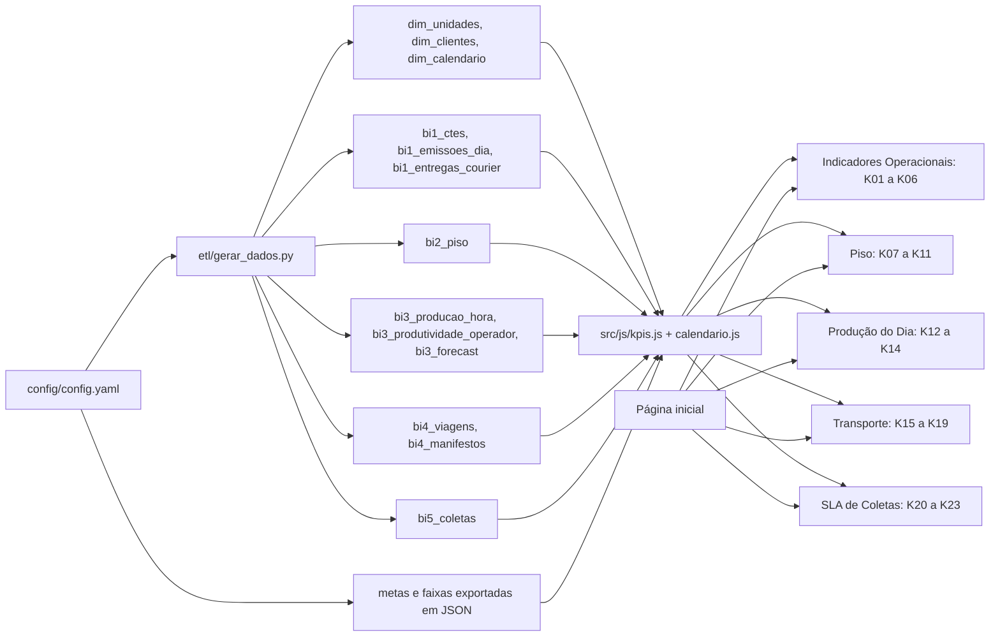

# 04 — Arquitetura

## Camadas
1. **Gerador** (`etl/`): script Python que lê `config/config.yaml`, gera as bases sintéticas, valida contra o dicionário e grava JSON.
2. **Dados** (`src/dados/`): um JSON por base e, com o mesmo conteúdo, um `.js` que o site carrega (ADR-017). Somente leitura para o site.
3. **Site** (`src/`): páginas HTML, CSS e JavaScript. `src/js/kpis.js` concentra o cálculo dos 23 KPIs; `src/js/calendario.js` concentra dias úteis e feriados.
4. **Publicação** (`dist/`): cópia de `src/` pronta para o GitHub Pages, gerada por um script simples de cópia.

## Linhagem

Todos os KPIs são calculados no navegador, em `kpis.js`, a partir das bases filtradas. O gerador não grava KPI pronto; grava apenas bases e, onde o detalhe não é necessário, agregações.

## Parâmetros de config/config.yaml
| Chave | Uso |
|---|---|
| empresa.nome, empresa.aviso | Cabeçalho e aviso de dados fictícios |
| geracao.semente | Reprodutibilidade do gerador |
| geracao.data_referencia, geracao.data_inicio | Janela de 90 dias e "hoje" de todos os cálculos |
| geracao.linhas | Volume de cada base |
| geracao.operadores_por_unidade, geracao.couriers_por_unidade | Tamanho das equipes sintéticas |
| calendario.dias_uteis, calendario.feriados_nacionais | Cálculo de dias úteis |
| regionais, unidades, clientes | Dimensões |
| metas | Meta, sentido e tolerância do semáforo por KPI |
| faixas | Faixas de aging e de peso |
| qualidade | Limites das checagens de docs/08 |
| caminhos | Pastas de dados, site e publicação |

O gerador exporta metas, faixas, feriados e data de referência para um JSON em `src/dados/`, para que o site não tenha valores fixos no código.

## Tecnologias
- Site: HTML, CSS e JavaScript puros; ECharts em versão fixada.
- Gerador: Python com pandas e numpy.
- Testes: pytest, Playwright e `node --test`.
- Publicação: GitHub Actions e GitHub Pages.
