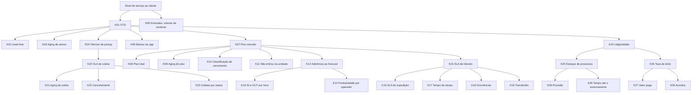

# 07 — Métricas e regras

As fórmulas foram confirmadas pelo autor em 09/11/2026. As metas são **fictícias e arbitradas**, apenas para demonstrar o semáforo.

## Fluxo e eventos
| Processo | Eventos em ordem | Colunas |
|---|---|---|
| Entrega (BI 1) | emissão, chegada na unidade de destino, 1ª tentativa, realizado | emissao, chegada, tentativa_1, realizado; prazo em limite_cliente |
| Piso (BI 2) | último evento na unidade, transferência, entrada na unidade de destino | data_evento, transferido_em, entrou_unidade |
| Produção (BI 3) | recebimento (IN) e expedição (OUT) por hora | data, hora, volumes_in, volumes_out |
| Transporte (BI 4) | saída prevista, saída real, término previsto, término real | saida_prevista, saida_real, termino_previsto, termino_real |
| Coleta (BI 5) | solicitação, depósito no ponto, retirada pelo motorista | solicitacao, deposito_ponto, retirada_motorista; prazo em prazo |

## Calendário
- Dia útil: segunda a sexta, exceto feriado nacional (07/09/2026, 12/10/2026 e 02/11/2026).
- Dias úteis entre duas datas: quantidade de dias úteis depois da data inicial até a data final, inclusive. Datas iguais resultam em 0.
- Data de referência: 31/10/2026. Faz o papel de "hoje" em todos os cálculos.
- Histórico: 90 dias, de 03/08/2026 a 31/10/2026.
- Não há turnos nem cut-off neste projeto; a produção é lida por hora cheia, das 6h às 21h.

## Regras gerais
- Unidade de contagem padrão: CT-e. Volumes e peso (kg) aparecem em emissões e produção.
- Filtros: período, unidade, UF/regional e cliente. O período filtra pela data indicada em cada KPI.
- Comparação: mesmo número de dias imediatamente anterior ao período filtrado. Sem período anterior completo nos dados, a comparação não é mostrada.
- Denominador zero: o KPI mostra "sem dados", nunca 0% nem erro.
- Arredondamento: percentuais com 1 casa decimal; médias de dias e horas com 1 casa; contagens inteiras.
- Semáforo: verde atinge a meta; amarelo fica fora da meta em até a tolerância de `config.yaml`; vermelho além disso.

## Árvore de métricas

## Glossário de KPIs

### BI 1 — Indicadores Operacionais (base bi1_ctes; período filtra limite_cliente)
| ID | KPI | Fórmula | Unidade | Meta | Comparação |
|---|---|---|---|---|---|
| K01 | OTD | CT-es com realizado preenchido e realizado até limite_cliente ÷ CT-es com limite_cliente no período | % | ≥ 95% | meta e período anterior |
| K02 | Lead time | Média dos dias úteis entre emissao e realizado, só CT-es realizados | dias úteis | sem meta | período anterior |
| K03 | Aging de atraso | Para CT-es fora do prazo: dias úteis entre limite_cliente e realizado, ou a data de referência se não realizado; contagem por faixa (1, 2–3, 4–5, 6+) | CT-es por faixa | sem meta | distribuição |
| K04 | % ofensor de pickup | CT-es com ofensor_pickup verdadeiro ÷ CT-es com limite_cliente no período | % | sem meta | período anterior |
| K05 | Emissões | Soma de remessas, volumes e peso_kg (base bi1_emissoes_dia; período filtra data) | remessas, volumes, kg | sem meta | período anterior |
| K06 | % baixas via app | Soma de baixas_app ÷ soma de entregas, total e por courier (base bi1_entregas_courier; período filtra data) | % | sem meta | período anterior |

Regras do K01: CT-e em aberto com limite_cliente até a data de referência conta como fora do prazo. CT-e com status devolvido entra no denominador e conta como fora do prazo. "Fora do prazo" em K03 é o complemento do numerador do K01.

### BI 2 — Piso – Vencimento por Cliente (base bi2_piso; foto na data de referência)
| ID | KPI | Fórmula | Unidade | Meta | Comparação |
|---|---|---|---|---|---|
| K07 | % do piso vencido | CT-es no piso com limite_cliente anterior à data de referência ÷ CT-es no piso | % | ≤ 5% | meta |
| K08 | Piso total | Contagem de CT-es no piso, por unidade atual e por cliente | CT-es | sem meta | entre unidades |
| K09 | Aging do piso | Dias corridos entre data_evento e a data de referência, contagem por faixa (0–1, 2–3, 4–7, 8+) | CT-es por faixa | sem meta | distribuição |
| K10 | Classificação de vencimento | Vencido: limite anterior à referência; vence hoje: limite igual à referência; a vencer: limite posterior | CT-es por classe | sem meta | distribuição |
| K11 | Não entrou na unidade | CT-es com transferido_em preenchido e entrou_unidade falso | CT-es | sem meta | entre unidades |

Regra do BI 2: por ser uma foto, o filtro de período atua sobre limite_cliente e não há comparação com período anterior. A unidade do filtro é a unidade atual.

### BI 3 — Produção do Dia (período filtra data)
| ID | KPI | Fórmula | Unidade | Meta | Comparação |
|---|---|---|---|---|---|
| K12 | Aderência ao forecast | Soma de volumes_in ÷ soma de volumes_previstos | % | ≥ 95% | meta e período anterior |
| K13 | Volumes IN e OUT por hora | Soma de volumes_in e de volumes_out por hora e por dia (mapa de calor hora × dia) | volumes | sem meta | média do período |
| K14 | Produtividade por operador | Soma de volumes ÷ soma de horas_trabalhadas, por operador | volumes por hora | sem meta | média da unidade |

Regra do K12: valores acima de 100% são válidos (produção acima do previsto) e aparecem em verde.

### BI 4 — Transporte e Transferências (período filtra a data de saida_prevista; em K19, data_transferencia)
| ID | KPI | Fórmula | Unidade | Meta | Comparação |
|---|---|---|---|---|---|
| K15 | SLA de trânsito | Viagens finalizadas com (termino_real − saida_real) menor ou igual a (termino_previsto − saida_prevista) ÷ viagens finalizadas | % | ≥ 92% | meta e período anterior |
| K16 | SLA de expedição | Viagens com saida_real até saida_prevista ÷ viagens com saida_real preenchida | % | ≥ 95% | meta e período anterior |
| K17 | Tempo médio de atraso | Média de (termino_real − termino_previsto) das viagens finalizadas com termino_real depois de termino_previsto | horas | sem meta | período anterior |
| K18 | Ocorrências por tipo | Contagem de viagens por ocorrencia, exceto "sem ocorrência", em Pareto | viagens | sem meta | distribuição |
| K19 | % transferido | Soma de ctes_transferidos ÷ soma de ctes_total (base bi4_manifestos) | % | ≥ 98% | meta e período anterior |

Regras do BI 4: viagens canceladas ficam fora de todos os KPIs. O filtro de unidade usa a unidade de origem. O filtro de cliente usa cliente_principal_id nas viagens e cliente_id nos manifestos.

### BI 5 — SLA de Coletas (base bi5_coletas; período filtra solicitacao)
| ID | KPI | Fórmula | Unidade | Meta | Comparação |
|---|---|---|---|---|---|
| K20 | SLA de coleta | Coletas com retirada_motorista preenchida e até o prazo ÷ coletas solicitadas, exceto canceladas | % | ≥ 90% | meta e período anterior |
| K21 | Aging da coleta | Média dos dias úteis entre deposito_ponto e retirada_motorista, só coletas retiradas | dias úteis | sem meta | período anterior |
| K22 | % cancelamento | Coletas com status cancelada ÷ coletas solicitadas, total e por motivo | % | sem meta | período anterior |
| K23 | Coletas por status e unidade | Contagem de coletas por status e por unidade | coletas | sem meta | entre unidades |

Regra do K20: coleta em aberto com prazo até a data de referência conta como fora do prazo; coleta em aberto com prazo futuro fica fora do denominador.

### BI 6 — Contencioso e Indenizações (base bi6_processos; aprovado pelo autor em 09/11/2026)
| ID | KPI | Fórmula | Unidade | Meta | Comparação |
|---|---|---|---|---|---|
| K24 | Litigiosidade | Processos com data_abertura no período ÷ soma de remessas emitidas no período (bi1_emissoes_dia) × 10.000 | processos por 10 mil remessas | ≤ 13,0 (75% do nível de 09/11/2026) | meta e período anterior |
| K25 | Estoque de processos | Processos com data_abertura até o último dia do período e sem data_encerramento até ele, por idade (0–90, 91–180, 181–365, 366+ dias corridos) e por tipo | processos | sem meta | estoque no fim do período anterior |
| K26 | Taxa de êxito | Processos ganhos ÷ processos ganhos ou perdidos, entre os com data_encerramento no período (acordos ficam fora) | % | ≥ 97% | meta e período anterior |
| K27 | Valor pago | Soma de valor_pago dos encerrados no período, e em % do valor_pedido deles | R$ | sem meta | período anterior |
| K28 | Provisão de risco provável | Soma de valor_provisionado dos processos em andamento com risco provável, na data de referência | R$ | sem meta | foto, sem comparação |
| K29 | Tempo até o encerramento | Média de dias corridos entre data_abertura e data_encerramento dos encerrados no período | dias | sem meta | período anterior |
| K30 | % de acordos | Encerrados em acordo ÷ encerrados no período | % | sem meta | período anterior |

Regras do BI 6: escopo só de processos ligados à operação (avaria, extravio, atraso); o trabalhista fica fora. Unidade e cliente são os responsáveis pelo processo. Processo encerrado no próprio dia de corte não está mais no estoque.

## Premissas registradas
As regras de borda de K01, K04, K15 e K20 (o que entra no denominador e como contar itens em aberto) foram propostas na documentação e estão listadas em `docs/decisoes.md` (ADR-007) para revisão do autor.
